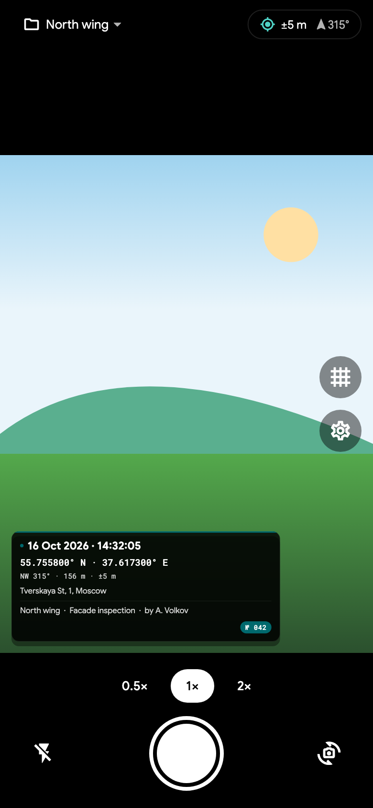
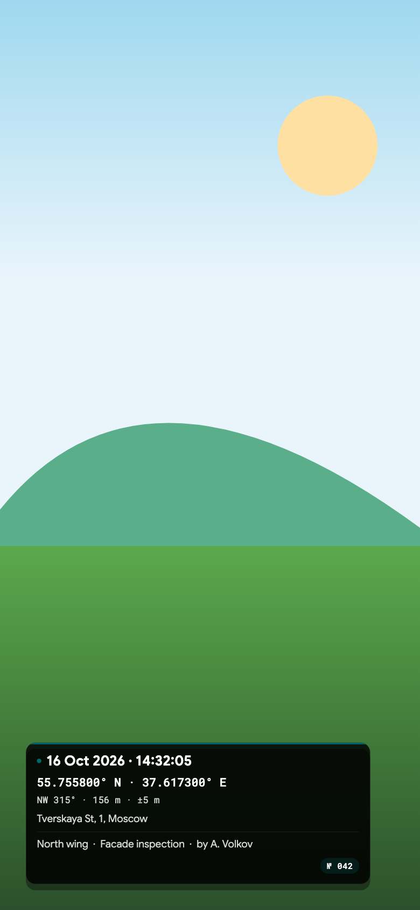
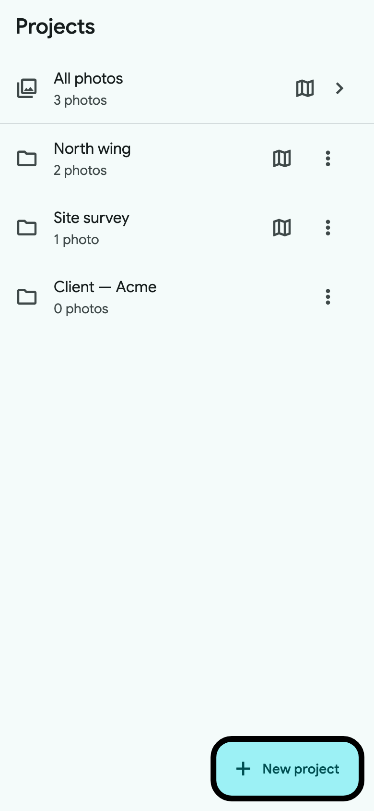
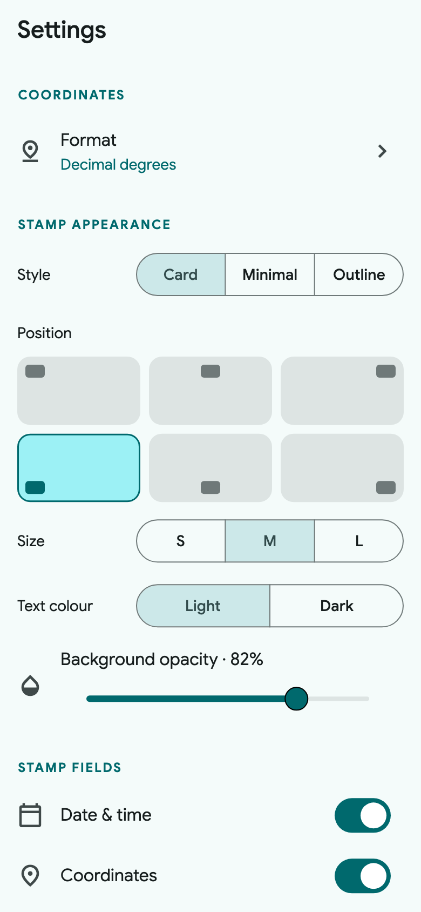
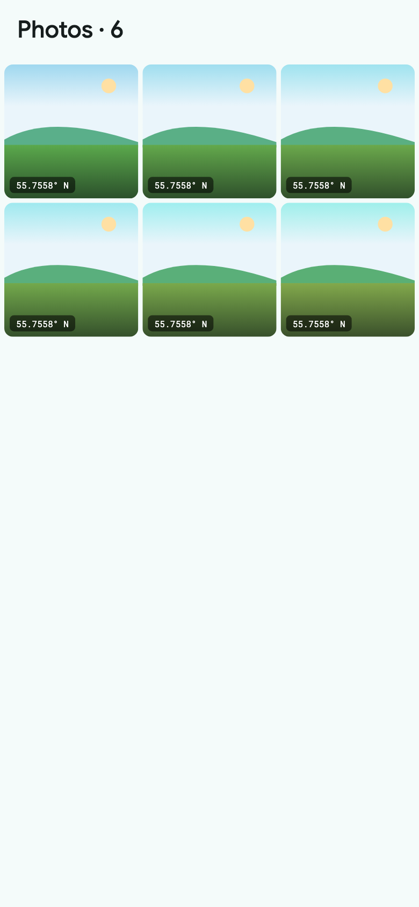

# PhotoTag

A small GPS camera for Android and iOS. Point, shoot, and the photo comes back
with coordinates, compass direction, altitude and time burned into the corner —
ready to drop into a report or send straight from the field.

*Русская версия — [README.ru.md](README.ru.md).*

## Features

- **In-app camera** that captures at the sensor's full resolution
- **Watermark** with coordinates (decimal, DMS, DDM, UTM, MGRS), bearing,
  altitude, accuracy, date/time, reverse-geocoded address, note, author and an
  automatic photo counter
- **Projects** to keep jobs, sites or clients apart
- **Export** a project to a ZIP archive — originals, watermarked, or both
- **English and Russian** interface
- **Offline first** — GPS and geocoding work without a connection
- Coordinates, altitude and direction are also written into the photo's EXIF
  metadata
- Saves to the system gallery and shares from the app
- Tap to focus, pinch to zoom, lens presets, flash, grid and a live stamp preview

## Screenshots

<table>
  <tr>
    <td></td>
    <td></td>
    <td></td>
  </tr>
  <tr>
    <td></td>
    <td></td>
    <td></td>
  </tr>
</table>

## Install

**Android** — [download the latest APK](https://github.com/skibidius/PhotoTag/releases/latest/download/phototag.apk)
and open it. Allow installation from unknown sources when prompted.

**iOS** — [download the latest IPA](https://github.com/skibidius/PhotoTag/releases/latest/download/phototag.ipa)
and install it with [AltStore](https://altstore.io/):

1. Install AltStore on your iPhone or iPad and sign in with your Apple ID.
2. Save `phototag.ipa` to the Files app.
3. Open AltStore → *My Apps* → **+** and pick the IPA (or share the file to AltStore).
4. AltStore signs the app with your account. A free Apple ID needs re-signing
   every 7 days; a paid developer account lasts a year.

## Running from source

You need Flutter 3.24 or newer.

```sh
flutter pub get
flutter run
```

## Building

Android:

```sh
flutter build apk --release
```

iOS:

```sh
flutter build ios --no-codesign
```

## License

MIT
