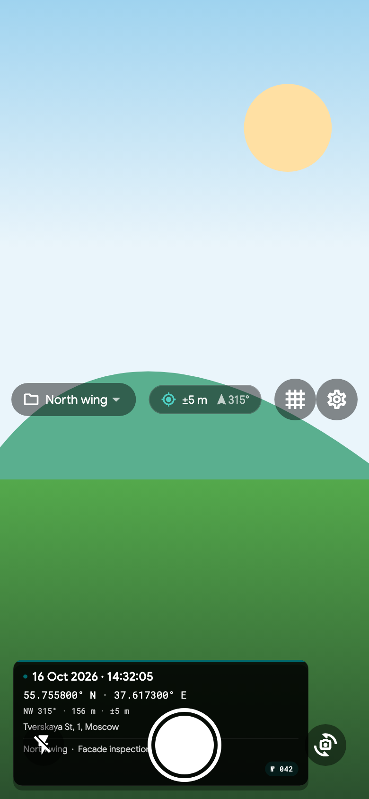
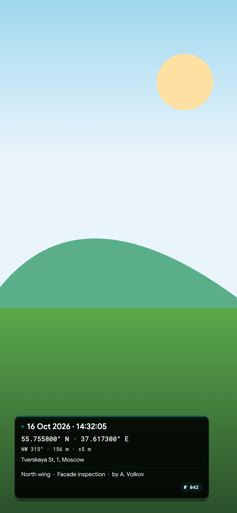
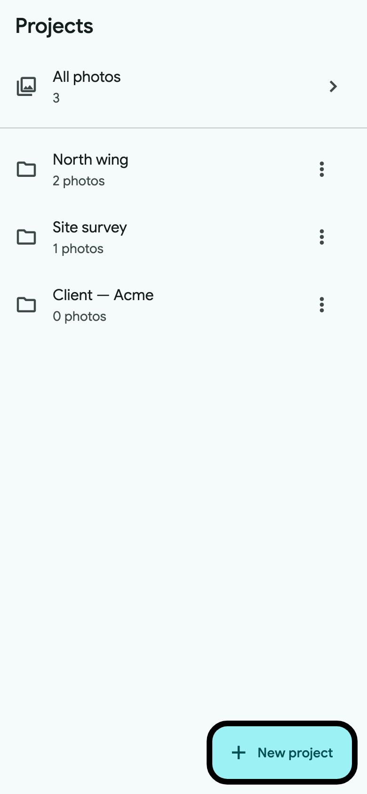
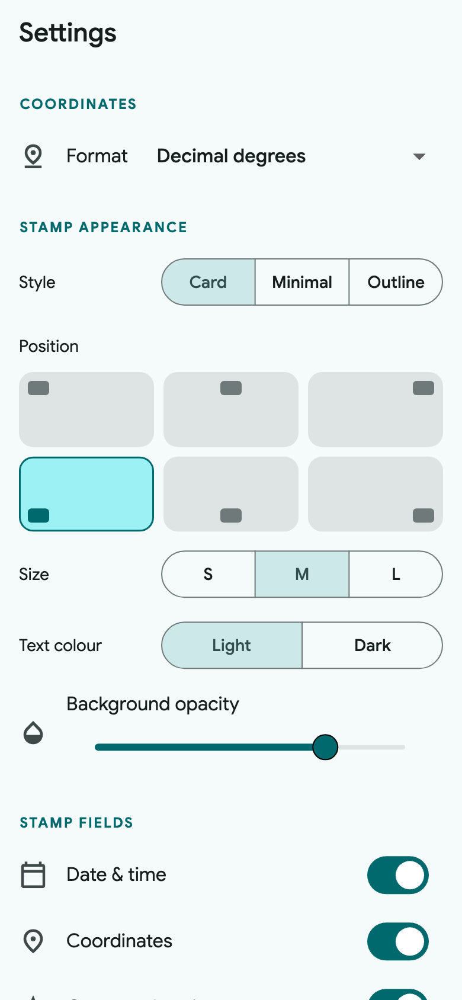

# PhotoTag

A small GPS camera for Android and iOS. Point, shoot, and the photo comes back
with coordinates, compass direction, altitude and time burned into the corner —
ready to drop into a report or email straight from the field.

It's meant to feel like a stock Google app: Material You, Google Sans, full
sensor resolution, and nothing that gets in the way.

## Features

- **In-app camera** that captures at the sensor's full resolution
- **Watermark** with coordinates (decimal, DMS, DDM, UTM, MGRS), bearing,
  altitude, accuracy, date/time, reverse-geocoded address, note, author and an
  automatic photo counter
- **Projects** to keep jobs, sites or clients separate
- **Offline first** — GPS and geocoding work without a connection
- Saves to the system gallery and shares from the app
- Compass, flash, zoom, grid and a live stamp preview

## Screenshots

<table>
  <tr>
    <td></td>
    <td></td>
    <td></td>
  </tr>
  <tr>
    <td></td>
    <td></td>
    <td></td>
  </tr>
</table>

## Running

You need Flutter (3.24 or newer).

```sh
flutter pub get
flutter run
```

## Building

Android:

```sh
flutter build apk --release
```

iOS:

```sh
flutter build ios --no-codesign
```

Both platforms build automatically on every push — see
`.github/workflows/ci.yml`. The artifacts are attached to tagged releases.

## License

MIT
