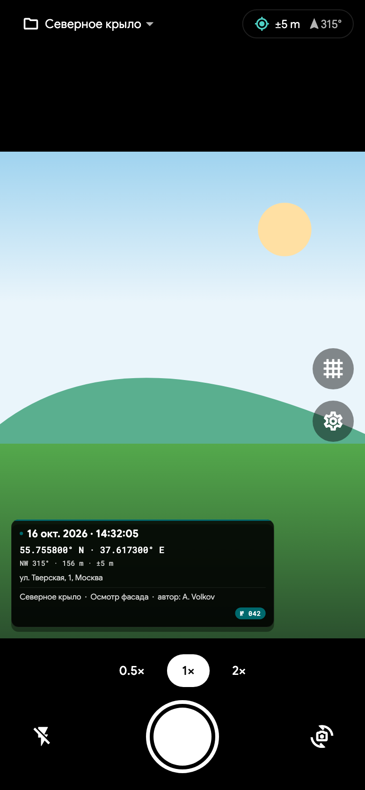
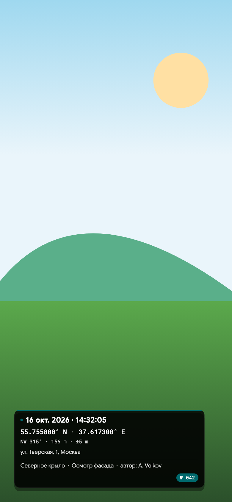
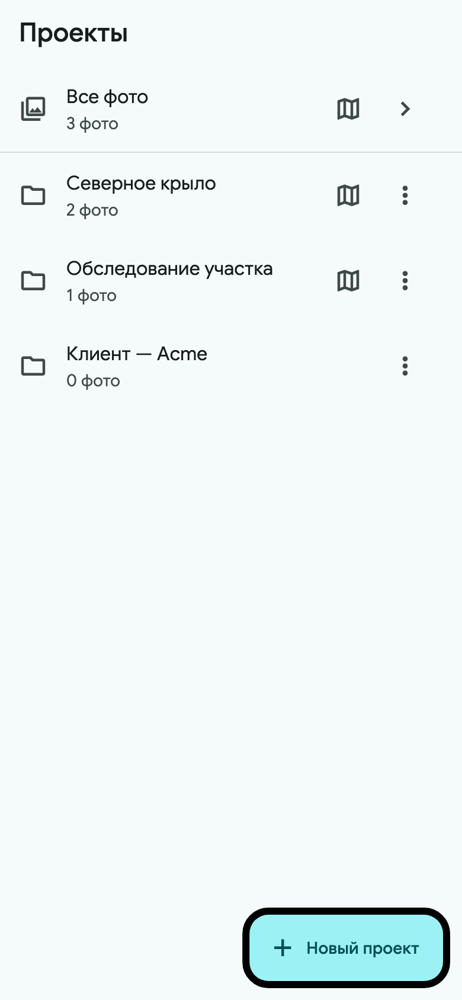
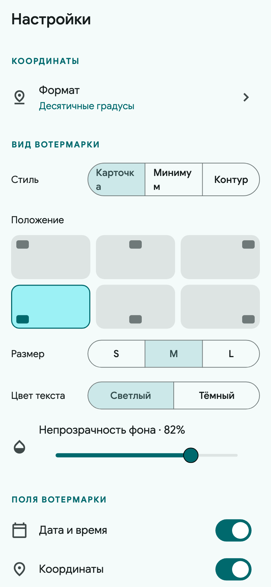
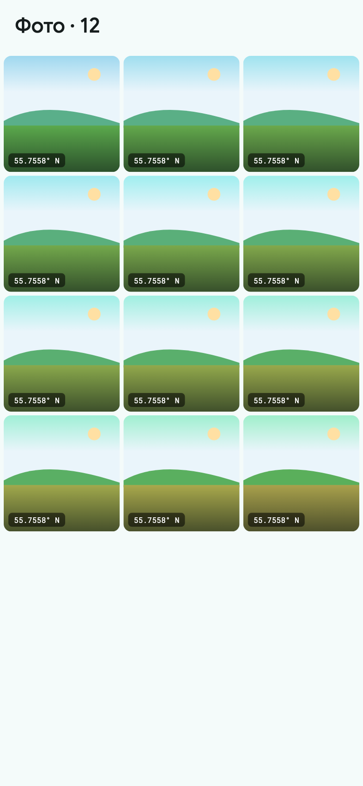

# PhotoTag

Небольшая GPS-камера для Android и iOS. Наводите, снимаете — и на фото сразу
отпечатываются координаты, азимут, высота и время. Готовый снимок можно
приложить к отчёту или сразу отправить с объекта.

*English version — [README.md](README.md).*

## Возможности

- **Встроенная камера** с выбором качества, зумом щипком и переключением
  объективов там, где платформа их отдаёт
- **Вотермарка** с координатами (десятичные, DMS, DDM, UTM, MGRS), азимутом,
  высотой, точностью, датой и временем, адресом, заметкой, автором и
  отдельным счётчиком снимков для каждого проекта
- **Проекты**, чтобы разделять объекты, задачи и заказчиков
- **Экспорт** проекта в ZIP — оригиналы, вотермарки или всё вместе
- **Русский и английский** интерфейс
- **Очередь в фоне** — можно снимать дальше, пока фото обрабатываются
- **Работает офлайн** — GPS и определение адреса не требуют сети
- Координаты, высота, направление, время, проект, заметка, автор и номер
  снимка также записываются в EXIF-метаданные (включая Unicode-поля), а не
  только выжигаются в пикселях
- Сохранение в системную галерею и отправка прямо из приложения
- Проверка обновлений в приложении
- Фокус по тапу, щипок для зума, пресеты объективов и зума, вспышка, сетка и
  живой предпросмотр вотермарки
- **Галерея в стиле Google Photos** — свайп вбок для просмотра, вниз — закрыть,
  вверх или тап — информация
- **Карта проекта** — все геометки проекта на одной карте: конус направления
  камеры, карточка фото и переключение подложек Яндекс, Google и OSM (выбор
  запоминается)

## Скриншоты

<table>
  <tr>
    <td></td>
    <td></td>
    <td></td>
  </tr>
  <tr>
    <td></td>
    <td></td>
    <td></td>
  </tr>
</table>

## Установка

**Android** — [скачайте последний APK](https://github.com/skibidius/PhotoTag/releases/latest/download/phototag.apk)
и откройте его. При необходимости разрешите установку из неизвестных источников.

**iOS** — установите [AltStore](https://altstore.io/) и нажмите
**[Добавить PhotoTag в AltStore](https://altstore.io/source/skibidius.github.io/PhotoTag/altstore.json?app=com.phototag)**
либо добавьте источник вручную в AltStore → *Sources* → **+**:

<https://skibidius.github.io/PhotoTag/altstore.json>

PhotoTag появится в AltStore и будет ставиться и обновляться в одно касание.
Если удобнее — [скачайте последний IPA](https://github.com/skibidius/PhotoTag/releases/latest/download/phototag.ipa)
и откройте его в AltStore.

AltStore подписывает приложение вашим Apple ID. С бесплатным аккаунтом подпись
нужно обновлять раз в 7 дней; с платным — раз в год.

## Запуск из исходников

Нужен Flutter 3.24 или новее.

```sh
flutter pub get
flutter run
```

## Сборка

Android:

```sh
flutter build apk --release
```

iOS:

```sh
flutter build ios --no-codesign
```

## RuStore

Пуш тега `v*` публикует приложение в RuStore прямо из GitHub Actions. Android-джоб
собирает второй APK с `--dart-define=PHOTOTAG_STORE=rustore`: эта сборка
использует официальный RuStore In-App Updates SDK, а обычный APK продолжает
проверять обновления в GitHub Releases. Затем RuStore-джоб создаёт черновик с
`publishType=INSTANTLY`, загружает APK и отправляет его на модерацию — после
одобрения RuStore публикует версию автоматически.

Разовая настройка:

1. Создайте приложение `com.phototag` в консоли RuStore и опубликуйте первую
   версию вручную (API умеет создавать черновик только при наличии активной
   версии).
2. Сгенерируйте Public API token в консоли и добавьте его в секреты GitHub
   Actions под именем `RUSTORE_PUBLIC_TOKEN`. Без секрета RuStore-джоб
   пропускается, а релиз на GitHub всё равно выходит.
3. Отправьте тег `v*`.

Сборки не мешают друг другу: пользователи RuStore обновляются через RuStore,
пользователи GitHub/AltStore — через GitHub Releases.

## Поддержка

Если PhotoTag помогает вам, можно [поддержать проект](https://pay.cloudtips.ru/3dc66105).

## Лицензия

MIT
